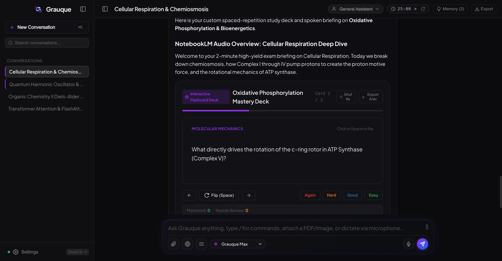
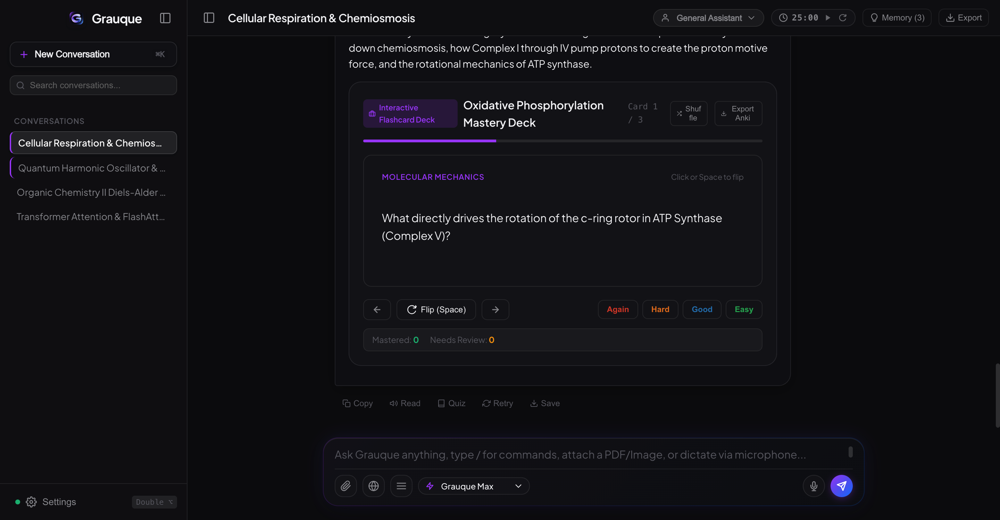

<p align="center">
  
</p>

<h1 align="center">Grauque</h1>

<p align="center">
  <strong>Ultra-fast, intelligent macOS desktop assistant powered by Groq.</strong><br>
  Featuring NotebookLM-grade study tools, native Apple PDFKit document analysis, persistent AI memory, Groq Whisper voice dictation, KaTeX math/chemistry rendering, and global double-tap Option spotlight search.
</p>

<p align="center">
  <a href="https://github.com/thepc101/grauque/releases/latest"></a>
  <a href="https://github.com/thepc101/grauque/releases"></a>
</p>

<p align="center">
  
  
  
  
  
  
  
</p>

---

## Visual Showcase

<p align="center">
  
</p>

<p align="center">
  <em>Grauque Desktop: Active recall quiz runner, KaTeX chemical equations, and native Apple PDFKit document grounding.</em>
</p>

<br>

<p align="center">
  
</p>

<p align="center">
  <em>NotebookLM Study Suite: Interactive 3D Flashcards with Leitner spaced repetition, Anki export, and spoken Audio Overview deep dives.</em>
</p>

---

## Table of Contents

- [Overview](#overview)
- [NotebookLM-Grade Study Suite](#notebooklm-grade-study-suite)
  - [Interactive Self-Grading Quiz Engine](#interactive-self-grading-quiz-engine)
  - [3D Interactive Flashcard Deck Runner](#3d-interactive-flashcard-deck-runner)
  - [NotebookLM Spoken Audio Overview Deep Dives](#notebooklm-spoken-audio-overview-deep-dives)
  - [1-Click Turn Assessments ("Quiz Me")](#1-click-turn-assessments-quiz-me)
  - [High-Yield Exam Cram Sheets & Socratic Tutor](#high-yield-exam-cram-sheets--socratic-tutor)
- [Key Features](#key-features)
  - [Apple Dark Obsidian Brand Aesthetic](#apple-dark-obsidian-brand-aesthetic)
  - [Native Apple PDFKit Document Intelligence](#native-apple-pdfkit-document-intelligence)
  - [Persistent AI Memory](#persistent-ai-memory)
  - [Groq Whisper Voice-to-Text](#groq-whisper-voice-to-text)
  - [Mathematical LaTeX & Chemistry (KaTeX)](#mathematical-latex--chemistry-katex)
  - [Global Double-Tap Option (⌥⌥) Quick Prompt](#global-double-tap-option--quick-prompt)
- [Rebranded Groq Models](#rebranded-groq-models)
- [Installation](#installation)
- [Keyboard Shortcuts](#keyboard-shortcuts)
- [Building from Source](#building-from-source)
- [Architecture & Tech Stack](#architecture--tech-stack)
- [License](#license)

---

## Overview

**Grauque** (pronounced */ɡʁok/*) is a native macOS desktop assistant built specifically for Intel Macs (`x86_64`) that connects directly to Groq's low-latency inference engine. Delivering responses at up to **300+ tokens per second**, Grauque features an Apple dark obsidian aesthetic with subtle gradient accents, typography powered by SF Pro, and an academic study engine modeled after Google NotebookLM.

---

## NotebookLM-Grade Study Suite

Grauque transforms textbooks, lecture slides, and notes into an active learning workspace:

### Interactive Self-Grading Quiz Engine
- **Resilient Multi-Format Extraction**: Parses both structured code blocks and plain numbered markdown questions into interactive test widgets with 100% reliability.
- **Instant Validation & Explanations**: Click any answer option to reveal instant color-coded feedback and thorough pedagogical rationales.
- **Web Audio Chimes**: Auditory feedback with synthesized sine wave chimes for correct responses and lower-register tones for review questions.
- **Letter Grades & Performance Badging**: Evaluates scores into standard academic letter grades (A+, A, B, C, Needs Review) with visual progress meters.
- **1-Click Flashcards from Missed Questions**: Instantly generates a focused flashcard remediation deck targeting only the questions you missed.
- **Assessment Export**: Export the full quiz to formatted Markdown (`.md`) with one click.

### 3D Interactive Flashcard Deck Runner
- **True 3D Spatial Flip Cards**: Realistic perspective flip cards with front/back cues, subject categories, and keyboard navigation (`Space` to flip, `ArrowLeft`/`ArrowRight` to navigate).
- **Leitner Spaced Repetition**: Rate card retention (**Again**, **Hard**, **Good**, **Easy**) with real-time deck mastery counters.
- **Deck Shuffling**: Randomize question order on the fly.
- **1-Click Anki Export (`.txt`)**: Seamlessly export decks to standard tab-separated format for direct import into Anki desktop or mobile.

### NotebookLM Spoken Audio Overview Deep Dives
- **Spoken Audio Briefings**: Generates conversational executive study deep dives breaking down complex concepts.
- **Animated Audio Waveform Player**: Real-time pulsing sound wave visualizer with native SpeechSynthesis audio controls.
- **Variable Playback Speed**: Toggle between 1.0x, 1.25x, and 1.5x narration speeds.
- **Expandable Transcript**: Full written briefing transcript accessible under the audio player card.

### 1-Click Turn Assessments ("Quiz Me")
- Every assistant explanation features a dedicated **Quiz** action button in its bottom toolbar. Test yourself on any concept the AI explains with a single click.

### High-Yield Exam Cram Sheets & Socratic Tutor
- **Cram Sheet Generator**: Distills dense PDFs and lecture transcripts into core equations, high-yield definitions, and common exam pitfalls.
- **Socratic Problem Solver**: Guides students through STEM problems step-by-step using progressive hints without immediately giving away the final solution.

---

## Key Features

### Apple Dark Obsidian Brand Aesthetic
- **Minimalist Vector Identity**: A modern geometric levitation glyph combining an upward quantum trajectory with an orbital loop, styled with electric cyan, vibrant azure, and deep indigo.
- **Refined Dark Surfaces**: Solid obsidian panels (`#101014`), subtle gradient border framing, and a soft feathered bloom around the prompt area.
- **Zero Emojis**: Clean, professional SF Symbols-style vector iconography across all toolbars, menus, and toasts.

### Native Apple PDFKit Document Intelligence
- **Hardware-Accelerated Extraction**: Uses macOS's native `PDFKit.framework` compiled via Objective-C (`bin/pdf-extract`) to parse lecture slides, research papers, syllabi, and textbooks in milliseconds with 100% unicode fidelity.
- **Zero Cloud Leakage**: PDF extraction happens 100% locally on your Mac—no external parsing APIs.
- **Drag-and-Drop & Attach**: Click the unified attachment button, paste from clipboard, or drag and drop any `.pdf` directly onto the chat input.
- **Interactive Action Pills**: Attached documents display page and word counts, with instant 1-click workflows for Summarize, Study Guide, Flashcards, Quiz, and Audio Overview.

### Persistent AI Memory
- **Conversational Memory Detection**: Simply chat naturally (e.g. *"Remember that I am taking Organic Chemistry II and prefer concise math proofs"*). Grauque automatically detects the intent, updates your memory profile, and confirms via toast notification.
- **Automatic Context Injection**: Your saved courses, research topics, and pedagogical preferences are injected across all current and future chats.
- **Dedicated Memory Modal**: Inspect, manually add, delete, or clear memories anytime from the top bar.

### Groq Whisper Voice-to-Text
- Click the microphone button in the prompt toolbar to speak your prompts.
- Audio is transcribed directly through Groq's high-speed `whisper-large-v3-turbo` model with near-zero latency.

### Mathematical LaTeX & Chemistry (KaTeX)
- Native rendering for inline math (`$...$`) and display equation blocks (`$$...$$`).
- Chemistry equation support via `mhchem` (e.g. $\ce{NADH + H+ + 1/2 O2 + 3 ADP + 3 Pi -> NAD+ + H2O + 3 ATP}$).
- Smart price protection prevents currency amounts like `$50` from falsely rendering as LaTeX formulas.

### Global Double-Tap Option (`⌥⌥`) Quick Prompt
- Tap the `Option` (`⌥`) key twice from anywhere in macOS to summon a floating spotlight prompt.
- Press `Enter` to switch to Grauque and begin streaming the response immediately.
- Includes universal fallback shortcut (`⌥Space`).

---

## Rebranded Groq Models

| Rebranded Name | Underlying Groq Model | Primary Use Case | Context Window |
| :--- | :--- | :--- | :--- |
| **Grauque Max** | `openai/gpt-oss-120b` | **Default Flagship**: Deep STEM reasoning, complex math proofs, multi-page document synthesis | 131k |
| **Grauque Image** | `qwen/qwen3.8-27b` | **Multimodal Vision**: High-resolution analysis of diagrams, textbook figures, charts, and handwritten work | 131k |
| **Grauque Medium** | `openai/gpt-oss-20b` | **Rapid General Assistant**: Ultra-low latency conversational Q&A and coding | 131k |
| **Grauque Low** | `allam-2-7b` | **Lightweight Inference**: Minimal latency for straightforward queries | 8k |
| **Whisper** | `whisper-large-v3-turbo` | **Voice Transcription**: High-accuracy voice-to-text | Audio |

---

## Installation

1. Download the latest installer: **[Grauque Releases](https://github.com/thepc101/grauque/releases)**.
2. Open the DMG disk image.
3. Drag **Grauque** into your **Applications** folder.
4. Launch **Grauque** from Applications or Spotlight (`⌘Space`).
5. Open **Settings** (`⌘,`) and paste your Groq API key (available for free at [console.groq.com/keys](https://console.groq.com/keys)).

> **macOS Accessibility Permission**: To enable global double-tap Option (`⌥⌥`) invocation, grant accessibility permission in **System Settings > Privacy & Security > Accessibility** when prompted.

---

## Keyboard Shortcuts

| Shortcut | Action |
| :--- | :--- |
| **`⌥ ⌥`** *(Double-tap Option)* | Summon floating quick prompt from anywhere in macOS |
| **`⌥ Space`** | Universal global spotlight fallback |
| **`⌘ K`** | Start a new conversation |
| **`⌘ B`** | Toggle sidebar collapse |
| **`⌘ ,`** | Open Settings |
| **`Space` / `Enter`** | Flip 3D flashcard |
| **`←` / `→`** | Previous / next flashcard |
| **`Enter`** | Send prompt |
| **`Shift + Enter`** | Insert new line |

---

## Building from Source

### Prerequisites
- macOS 10.15 Catalina or newer (Intel `x86_64`)
- Node.js 18+ and `npm`
- Clang / Xcode Command Line Tools (`xcode-select --install`)

```bash
# 1. Clone the repository
git clone https://github.com/thepc101/grauque.git
cd grauque

# 2. Install dependencies
npm install

# 3. Compile native helpers (double-tap listener and PDFKit extractor)
npm run compile-helper

# 4. Run in development mode
npm start

# 5. Build production package
npm run pack
```

---

## Architecture & Tech Stack

```
Grauque/
├── assets/
│   └── screenshots/           # High-resolution application screenshots
├── bin/
│   ├── opt-tap-listener       # Native C/Cocoa event tap for ⌥⌥ detection
│   └── pdf-extract            # Native Apple PDFKit hardware-accelerated text extractor
├── src/
│   ├── main/
│   │   ├── main.js            # Electron main process, window management, IPC handlers
│   │   ├── preload.js         # Secure contextBridge IPC bridge
│   │   ├── pdf-parser.js      # Dual-engine PDF service (PDFKit + Node stream fallback)
│   │   └── native/            # Objective-C source files for native compilation
│   └── renderer/
│       ├── index.html         # Editorial UI structure and modals
│       ├── css/claude.css     # Typography, themes, animations, KaTeX styling
│       └── js/
│           ├── app.js                 # App coordinator, event orchestration, state
│           ├── groq-client.js         # Low-latency streaming SSE client & Whisper API
│           ├── memory-manager.js      # Persistent AI memory & intent detection
│           ├── student-studio.js      # Flashcards, Cram sheets, Tutor, Audio Overview
│           ├── quiz-manager.js        # Multiple-choice active recall engine
│           └── markdown-renderer.js   # Markdown-it + KaTeX math rendering
```

---

## License

This project is licensed under the [MIT License](LICENSE).
